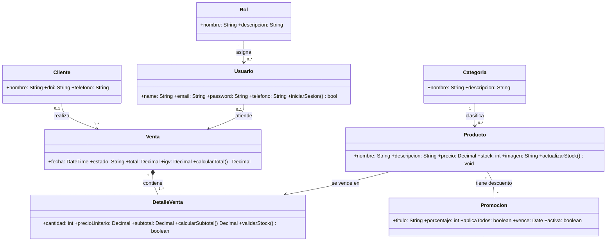

# Diagrama de clases corregido (guía 11, Paso 3)

Revisado con la tabla de observaciones: multiplicidades `0..*` en el lado «muchos», dinero en `Decimal`,
fecha de venta `DateTime`, nombres en singular y sin tildes, métodos en camelCase.

Tablas de apoyo sin relaciones: `ajustes` (datos de la tienda y portada, una sola fila) y `preguntas_frecuentes`.
